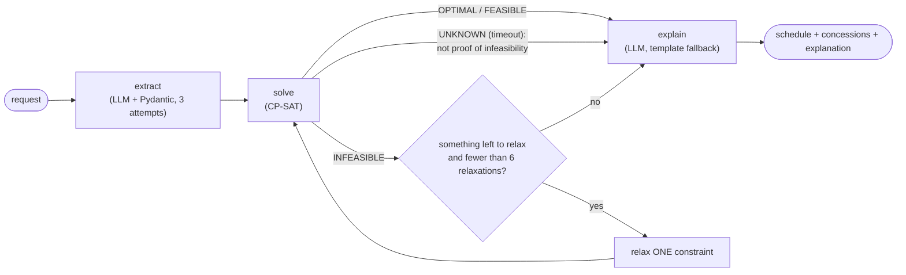

# ShiftWise

Describe a staffing problem in plain language and get back a weekly shift schedule that is
**guaranteed to respect every hard constraint**, together with a short explanation.

```text
"8 employees, 3 shifts per day, max 5 consecutive days, Sara doesn't work on Monday"
```

## The idea in one minute

LLMs are good at language and bad at guaranteeing constraints. Solvers are the opposite. So ShiftWise
splits the work and **the LLM never edits a schedule**:

1. **extract**: an LLM (Gemini, through LangChain structured output) translates the request into a
   `ScheduleProblem`. Pydantic validates it. If validation fails, the error is sent back to the model,
   which gets 3 attempts in total.
2. **solve**: OR-Tools CP-SAT builds a model with one boolean per (employee, day, shift), staffs every
   shift exactly as required, and minimizes the gap between the most and least loaded employee.
3. **relax**: if CP-SAT *proves* the request impossible, a LangGraph loop loosens **one** constraint
   and solves again, least harmful change first. It stops after 6 relaxations. Every concession is
   reported to the user.
4. **explain**: the LLM narrates the result using only the facts it is given. If that call fails, a
   deterministic template is used instead, so the schedule is never lost.



The conditional edge after `solve` is the agentic part: the graph decides at run time whether to loop.
Because the solver alone decides the schedule, every schedule returned satisfies the problem that was
extracted. A malformed LLM output is rejected by Pydantic before it reaches the solver.

## Results

All numbers are measured by the scripts in [evaluation/](evaluation/). Full reports and raw data are in
[evaluation/results/](evaluation/results/). The solver timings were measured on 2026-11-20 on a
laptop (Intel Core i5-1135G7, 4 cores / 8 threads, 8 GB RAM) with a 10 s limit per solve.

| What was measured | Result |
|---|---|
| Hard-constraint violations in CP-SAT schedules, checked by an independent validator (206 schedules) | **0** |
| Fairness (max - min shifts per employee) proven optimal | 206/206 solvable instances (the other 10 of 216 proven infeasible) |
| Solve time, 8 to 50 employees, 7 to 28 days | median 0.535 s, p95 2.186 s, max 2.930 s |
| Greedy baseline on the same instances | valid on 204/206; optimal fairness on 152/204 (74.5%) |
| Relaxation loop on 102 over-constrained (stress) instances | schedule recovered for 20/102 (19.6%); 33/73 concessions (45.2%) were avoidable |

**LLM extraction accuracy is not measured yet.** The first run of the LLM evaluation was interrupted:
the Gemini API was saturated (503/504 errors) and most requests could not complete. No LLM number is
reported until a complete run is available.

How to read these numbers:

- **"0 violations" is checked, not assumed.** [validator.py](validator.py) re-checks every schedule
  against every hard constraint without using the CP-SAT model. The same validator scores the greedy and
  LLM-only baselines.
- **A greedy heuristic is a strong baseline at light load.** It fails only under heavy load (valid on
  33/35 solvable heavy-load instances, mean gap 2.09 vs 1.09 shifts for CP-SAT). CP-SAT's real advantages
  are guaranteed validity, optimal fairness, and *proofs* of infeasibility. Those proofs are what
  trigger the relaxation loop. A greedy heuristic cannot tell "impossible" from "I did not find it".
- **The relaxation loop is a heuristic, and the stress test shows it.** On random instances with 15-30%
  unavailability it usually reaches the 6-relaxation cap: it drops unavailabilities one at a time, in list
  order, without knowing which one causes the conflict. When it does recover, 45.2% of its concessions
  could be undone and the problem would still be feasible. See [Limitations](#limitations).
- **The evaluation caught a real modelling bug.** The first version required *at least* the needed
  staff on each shift and minimized only the load gap. CP-SAT then "balanced" the loads by adding
  shifts nobody asked for: 120 shifts instead of 21 for 30 employees with 1 person per shift. Coverage is
  now an equality. This cannot cost feasibility, because removing a shift from a valid schedule never
  breaks another constraint. A regression test guards it.

## Run it in five minutes

Requirements: Python 3.12 and a Gemini API key from <https://aistudio.google.com/apikey>. The tests
and the solver benchmark need no key.

```bash
python -m venv .venv
source .venv/bin/activate            # Windows: .venv\Scripts\activate
pip install -r requirements.txt
cp .env.example .env                 # then paste your key into .env

pytest -q                            # offline: LLM calls are replaced by fakes
python graph.py "8 employees, 2 per shift, Sara doesn't work on Monday"
uvicorn api:app --reload             # then open http://localhost:8000/docs
```

```bash
curl -X POST localhost:8000/plan -H "Content-Type: application/json" \
     -d '{"request": "Team: Sara, Ali, Mona, Yassine, Leila, Omar. 2 people per shift."}'
```

The response contains the extracted `problem` (so the user can check what was understood), the
`result`, the list of `relaxations`, a text `schedule_text` and the `explanation`. HTTP status codes:
422 if the request cannot be turned into a valid problem, 503 if the LLM provider is unavailable.

| Endpoint | Purpose |
|---|---|
| `POST /plan` | text request -> final schedule, one JSON response |
| `POST /plan/stream` | same, streamed as Server-Sent Events: every node start/end, extraction attempt and routing decision |
| `POST /solve/stream` | structured `ScheduleProblem` -> streamed run with no LLM extraction (works without a key) |
| `GET /config`, `GET /evaluation`, `GET /health` | agent settings, measured results, liveness |

### Dashboard (Flutter)

[dashboard/](dashboard/) is a Flutter web app that shows the agent working live. It displays the graph
with each node's state, the event stream with the reason for every routing decision, the constraints
before and after relaxation, the schedule grid, load and coverage charts, and the independent check. It
also has a tab with the measured evaluation results.

```bash
uvicorn api:app --reload
cd dashboard && flutter pub get && flutter run -d chrome    # add ?demo=1 to the URL to auto-run an example
```

With Docker (the key is injected at run time, never baked into the image):

```bash
docker build -t shiftwise .
docker run --rm -p 8000:8000 --env-file .env shiftwise
```

Example: the request above needs 6 people every day from a team of 6. CP-SAT proves this impossible.
The agent then allows a 6th consecutive day (still infeasible), drops the rest rule (still
infeasible), and lowers staffing to 1 per shift:

```text
        |   Mon   Tue   Wed   Thu   Fri   Sat   Sun
Sara    | morni morni   off after   off   off   off
Ali     | night night after   off   off   off   off
Mona    | after after   off   off morni morni   off
Yassine |   off   off night   off night after morni
Leila   |   off   off   off morni   off night after
Omar    |   off   off morni night after   off night

status=OPTIMAL  shift_gap=1  time=0.083s

Schedule found (OPTIMAL); the gap between the most and least loaded employee is 1 shift(s).
To get there I had to relax:
- Allowed up to 6 consecutive working days (was 5).
- Allowed a morning shift right after a night shift.
- Lowered minimum staffing to 1 per shift (was 2).
```

(This is the template explanation. With an API key, the LLM narrates the same facts.) Lowering the
staffing alone would have been enough: the original problem with only that change is OPTIMAL. So the
first two concessions were unnecessary. This is the non-minimality that the evaluation measures.

### Reproduce the evaluation

```bash
python -m evaluation.bench_solver           # offline, about 10 minutes: CP-SAT vs greedy + relaxation stress test
python -m evaluation.eval_llm               # needs a key: 43 labelled requests, about 3-4 LLM calls each
python -m evaluation.eval_llm --report-only # rebuild the report from cached runs
```

`eval_llm` caches every request in `evaluation/results/llm_runs.jsonl` and resumes after API errors.
Use `--model` to evaluate another Gemini model.

## What the schema supports

| Field | Default | Meaning |
|---|---|---|
| `employees` | required | names, or "Employee 1..N" when only a headcount is given |
| `num_days` | 7 (max 31) | horizon, day 0 = Monday, "weekend" = days 5 and 6 |
| `shifts` | morning, afternoon, night | shift names |
| `min_staff_per_shift` | 1 | exact number of people on every shift of every day ("at least 2" is read as 2) |
| `max_consecutive_days` | 5 | max working days in a row |
| `unavailable` | none | (employee, day index) pairs |
| `no_morning_after_night` | true | forbid a morning shift right after a night shift |

Anything the user does not state keeps its default. The extractor is instructed never to invent
employees, days off or constraints, and the evaluation measures how often it does anyway.

Relaxation order, from least to most harmful: one more consecutive day (up to 6), drop the
morning-after-night rule, ignore the last listed unavailability, lower the staffing per shift.
Solver statuses: OPTIMAL = proven best; FEASIBLE = valid but not proven best when the time limit is
reached; INFEASIBLE = proven impossible; UNKNOWN = no answer within the limit. UNKNOWN never triggers a
relaxation.

## Limitations

- **The relaxation is a heuristic, not a minimal relaxation.** It follows a fixed order and
  ignores which constraints actually conflict. It is fully deterministic and every concession is shown
  to the user. Still, the stress test shows avoidable concessions and many give-ups at the cap. A natural
  next step is to let CP-SAT find a minimum-cost relaxation itself, with soft constraints or assumption
  literals and an infeasible core.
- **A small constraint set.** Out of scope: skills and roles, contracts and hour limits, leave
  ranges as a type, preferences, different staffing per shift, multi-week horizons with carry-over.
- **The guarantee covers the extracted problem, not the user's intent.** If extraction misreads the
  request, the schedule is valid for the wrong problem. The API returns the extracted problem so it can
  be checked, and the evaluation scores schedules against gold (expected) problems for this reason.
- **The LLM evaluation is small and its labels are not human-reviewed yet.** The 43 requests and
  their gold labels were drafted by an AI coding assistant (Claude) during development, before Gemini
  was run on any of them. They are checked automatically (schema validation; the solver confirms which
  requests are infeasible) but have not been reviewed line by line by a person. One run per request,
  so there is no variance estimate. The model and provider load affect latency. The check that
  explanations mention every concession is a keyword heuristic.
- Timings come from a single laptop.

## Project layout

| File | Role |
|---|---|
| [models.py](models.py) | Pydantic schema: the contract between the LLM and the solver |
| [scheduler.py](scheduler.py) | CP-SAT model, objective and text rendering |
| [extractor.py](extractor.py) | LLM extraction with validation-feedback retries |
| [graph.py](graph.py) | LangGraph agent: extract, solve, relax loop, explain |
| [api.py](api.py) | FastAPI service: `/plan`, streaming endpoints for the dashboard, `/config`, `/evaluation` |
| [validator.py](validator.py) | Independent constraint checker used by tests and evaluation |
| [evaluation/](evaluation/) | Benchmarks, labelled requests, baselines and measured results |
| [dashboard/](dashboard/) | Flutter web dashboard: live agent trace, schedule, evaluation results |
| `test_*.py` | Offline test suite (no API key needed) |
